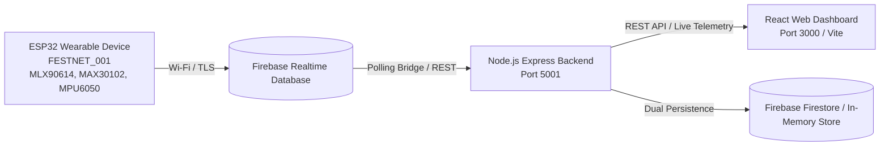

# FestNet: Smart Festival Monitoring & Emergency Command System

**FestNet** is an IoT-enabled festival crowd monitoring, attendee wellness management, and emergency dispatch platform. It bridges wearable physical sensors, real-time wireless telemetry, backend analytics engines, and an incident command web dashboard.

---

## 👥 Research Component Focus
**Student**: Bandara W.M.T.N. (IT23377158)  
**Specialization Component**: **Hydration & Wellness Management**

### Key Research Features Implemented:
- **WBGT-Inspired Heat Stress Index**: Real-time integration of heart rate (BPM) and body temperature ($T_{\text{body}}$) into a 4-tier color-coded physiological risk tier (**Low**, **Moderate**, **High**, **Critical**).
- **Personalised Dynamic Hydration Reminders**: Replaces static 30-minute timers with a dynamic algorithm driven by linear regression trend gradients of attendee BPM.
- **Hydration Logging & Compliance Tracking**: Interactive manual water intake log, automated daily compliance score ($2,500\text{ ml}$ target), and timestamped audit logs.
- **Wellness Analytics Dashboard**: Continuous trend monitoring including hourly BPM ranges, $\text{SpO}_2$ blood oxygen history, heat stress exposure durations, and hydration scores.
- **Post-Event Wellness Report**: Summary of cardiac peaks, high-risk heat stress periods, alert logs, and fluid intake across the event timeline.
- **Hardware Integration & Firebase Cloud Persistence**: Real-time data pipeline from ESP32 wearable hardware through Firebase Realtime Database into the Express backend and React dashboard.

---

## 🏗️ System Architecture



---

## 📐 Heat Stress & Hydration Mathematical Models

### 1. WBGT-Inspired Heat Stress Index
$$\text{WBGT} \approx 0.7 \times T_{\text{body}} + \left(\frac{\text{BPM}}{5}\right) \times 0.1 + 3.94$$

- **Low ($< 26^\circ\text{C}$)**: Safe conditions. Standard 30-minute interval.
- **Moderate ($26^\circ\text{C} \le \text{WBGT} < 32^\circ\text{C}$)**: Mild thermal load. Interval adjusted to 20–25 minutes.
- **High ($32^\circ\text{C} \le \text{WBGT} < 38^\circ\text{C}$)**: Elevated heat exhaustion risk. Interval shortened to 15 minutes.
- **Critical ($\ge 38^\circ\text{C}$)**: Extreme hyperthermia risk. 10-minute reminders and automated safety alerts.

### 2. Linear Regression Gradient for Heart Rate
$$m = \frac{n \sum (xy) - \sum x \sum y}{n \sum (x^2) - (\sum x)^2}$$

- $m \le 0 \implies 30\text{ min}$
- $0 < m \le 2 \implies 25\text{ min}$
- $2 < m \le 5 \implies 20\text{ min}$
- $5 < m \le 10 \implies 15\text{ min}$
- $m > 10 \implies 10\text{ min}$

---

## 🔌 Hardware Setup & Pin Mapping

- **Microcontroller**: ESP32 DevKit V1 (30-pin / 38-pin)
- **Firmware Location**: [`Firmware/src/wearable_device/wearable_device.ino`](Firmware/src/wearable_device/wearable_device.ino)

| Component / Sensor | Interface | Pin on ESP32 | Description |
|---|---|---|---|
| **SSD1306 OLED (128x64)** | I2C | `VCC` $\to$ `3V3`, `GND` $\to$ `GND`<br>`SCL` $\to$ `GPIO 22`, `SDA` $\to$ `GPIO 21` | Real-time display for status, temp, heart rate |
| **MLX90614** | I2C | `VCC` $\to$ `3V3`, `GND` $\to$ `GND`<br>`SCL` $\to$ `GPIO 22`, `SDA` $\to$ `GPIO 21` | Non-contact infrared temperature sensor |
| **MAX30102** | I2C | `VCC` $\to$ `3V3`, `GND` $\to$ `GND`<br>`SCL` $\to$ `GPIO 22`, `SDA` $\to$ `GPIO 21` | Pulse oximetry & optical PPG sensor |
| **MPU6050** | I2C | `VCC` $\to$ `3V3`, `GND` $\to$ `GND`<br>`SCL` $\to$ `GPIO 22`, `SDA` $\to$ `GPIO 21` | 6-DOF motion accelerometer & gyro |
| **NEO-6M GPS** | UART (Serial2) | `VCC` $\to$ `3V3`/`5V`, `GND` $\to$ `GND`<br>`RX` $\to$ `GPIO 17 (TX2)`, `TX` $\to$ `GPIO 16 (RX2)` | Outdoor attendee positioning |
| **SOS Push Button** | Digital GPIO | `GPIO 27` (Internal Pull-Up) | Emergency call button |

---

## 🚀 How to Run the Project

### Prerequisites
- Node.js (v18+)
- npm
- Arduino IDE (if compiling/flashing the ESP32)

### 1. Start the Backend API Server
```powershell
# Open terminal in project root
cd Backend/functions
npm install
npm start
```
- Server URL: **`http://localhost:5001`**
- Starts the IoT Bridge polling `FESTNET_001` from Firebase and serving wellness REST APIs.

### 2. Start the React Web Dashboard
```powershell
# Open a second terminal in project root
cd Dashboard
npm install
npm run dev
```
- Dashboard URL: **`http://localhost:3000`**

---

## 🌐 API Reference (Hydration & Wellness)

| Method | Endpoint | Description |
|---|---|---|
| `POST` | `/api/telemetry` | Ingests wearable GPS and sensor telemetry |
| `GET` | `/api/telemetry/live` | Retrieves real-time active devices |
| `GET` | `/api/iot/snapshot` | Returns live sensor health status from physical hardware |
| `POST` | `/api/wellness/reading` | Ingests BPM & temperature; calculates WBGT & dynamic reminders |
| `POST` | `/api/wellness/hydration` | Records water intake volume and returns compliance score |
| `GET` | `/api/wellness/reminder/:deviceId` | Returns next reminder countdown and gradient interval |
| `GET` | `/api/wellness/dashboard/:deviceId` | Returns hourly aggregated wellness snapshots |
| `GET` | `/api/wellness/report/:deviceId` | Generates full post-event wellness report |

---

## 📂 Project Directory Structure

```
FestNet-J26-IT-427/
├── Backend/
│   └── functions/
│       ├── src/
│       │   ├── controllers/      # REST API route handlers
│       │   ├── services/         # Wellness & telemetry business logic
│       │   │   ├── ioTBridgeService.ts
│       │   │   ├── wellnessService.ts
│       │   │   └── telemetryService.ts
│       │   ├── repositories/     # Storage layer (Firestore / In-memory)
│       │   │   └── wellnessRepository.ts
│       │   ├── utils/            # WBGT & linear regression algorithms
│       │   │   └── wellnessCalculator.ts
│       │   ├── server.ts         # Server startup & IoT bridge launch
│       │   └── index.ts          # Express API route mapping
├── Dashboard/
│   └── src/
│       ├── features/
│       │   ├── heat_wellness/    # Heat Stress & Hydration dashboard
│       │   ├── reports_analytics/# Post-event wellness reports
│       │   ├── event_overview/   # Event overview page
│       │   └── emergency_command/# Incident response & SOS alerts
│       ├── utils/
│       │   └── wellnessUtils.ts  # Client-side formulas & SVG chart helpers
│       ├── types/                # TypeScript interfaces
│       └── app/                  # Main layout & router
└── Firmware/
    └── src/
        └── wearable_device/
            └── wearable_device.ino  # ESP32 firmware for all sensors
```
