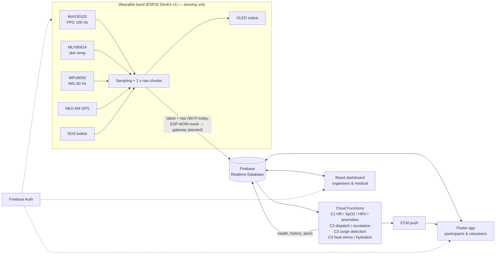

# FestNet Architecture Overview

## Data flow

1. **Band → RTDB (raw only).** The band signs in with its own Firebase Auth account. Every 2 s it
   `set`s `/festnet/devices/{deviceId}/latest` (current reading of every sensor) and pushes a
   `raw/{pushId}` chunk with the full-rate PPG (100 Hz) and IMU (50 Hz) signals. It does no calculations.
2. **RTDB → Cloud Functions → RTDB.** Database triggers compute everything:
   - **C1:** BPM, SpO2, HRV and stress from the PPG; core temperature; fall and stillness from the IMU; anomaly detection → `health`, `history`, `alerts`.
   - **C2:** FCM dispatch, volunteer proximity (Haversine, 50 m), auto-escalation after 2 min.
   - **C3:** crowd flow and surge detection.
   - **C4:** heat stress and hydration.
3. **RTDB → apps.** The dashboard and the app subscribe to the computed nodes with the Firebase
   SDKs. They never talk to the band. No custom server is needed.

## Design decisions

| Decision | Reason |
|---|---|
| Realtime Database rather than Firestore | Low-latency streaming of small, frequently overwritten documents; the band's existing code already uses it |
| One shared contract (`docs/database/schema.md` + `Backend/functions/src/shared`) | Four people build against the same data; a single source avoids drift |
| `deviceIndex/` node | Apps list bands without downloading every band's `history` |
| Online status from **client receive time** | Independent of the band's clock (works before NTP sync) |
| Band uploads raw signals; **all calculations in the backend** | One place to develop, tune and validate algorithms (no re-flashing); raw data is kept for research analysis. Trade-offs: needs the Blaze plan for Functions, ~2–3 s detection delay (2 s chunk + function), and no detection while the band is offline |
| Raw chunks pruned by the backend | ~12 MB/hour per band — keep minutes of raw data, keep computed `history` long-term |
| Band per-device Auth accounts + `deviceAuth/{uid}` | Security rules can limit each band to writing only its own node |

## Security model (summary — see `Backend/database.rules.json`)

| Who | Can read | Can write |
|---|---|---|
| Band (device account) | own `devices/{id}` | own `latest`, `raw`, `meta` (`history`, `location` and `alerts` are also permitted) |
| Cloud Functions (Admin SDK) | everything | everything (bypasses rules) — writes `health`, `history`, `alerts` |
| Participant | own `users/{uid}`, paired band's `devices/{id}`, `events`, `deviceIndex`, own `wellness` | own profile (cannot raise own role), claim an unpaired band |
| Volunteer | as participant + `alerts` | as participant |
| Medical | all `devices`, `users`, `alerts`, `wellness` | `alerts` (acknowledge / resolve) |
| Organiser | everything above | `config`, `events`, `deviceIndex`, `deviceAuth`, user roles |

## Planned: ESP-NOW mesh

The TAF goal is that bands do not each need Wi-Fi. The planned design: bands send compact packets
over ESP-NOW to a **gateway ESP32**, and the gateway uploads to Firebase using the same JSON and
paths. Apps and Functions need no changes, because the database contract stays the same.
