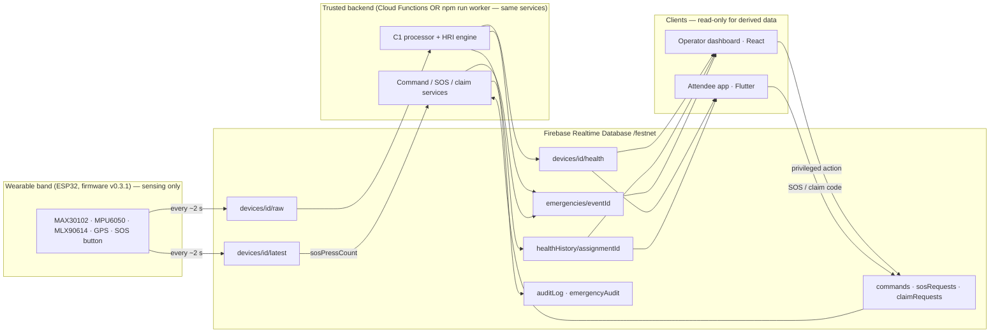

# FestNet Architecture Overview (C1 v2)

## 1. Components and data flow

* The band never calculates health values; clients never write derived data or privileged state.
* Every privileged action (assign, return, claim codes, alert lifecycle, roles, exports) is a
  **request** in a queue node. The backend re-checks the caller's role, validates the payload,
  executes it with transactions where needed, writes the result back and appends an audit entry.
* The same TypeScript services run as Cloud Functions (Blaze plan) or as the local worker
  (`Backend/scripts`, Spark plan). Commands are claimed with a transaction, so running both cannot
  execute one twice — but run only one processor in practice.

## 2. Roles and access (enforced by `database.rules.json` + backend)

| Role | Scope | Can | Cannot |
|---|---|---|---|
| attendee | own account | read own linked band's `latest`/`health`, own `healthHistory`, `eventsPublic`; write own profile, SOS and claim requests | read other bands, events, emergencies; claim a band by device ID |
| eventOperator | one event | everything in their event: live health, emergencies + lifecycle, participants, assignments, claim codes, event info, staff, event audit log | other events; global roles; research exports |
| medicalResponder | one event | live health and emergencies of their event; alert lifecycle and review | assignments, staff, audit log |
| deviceAdmin | global | inventory, events, global roles, `_unassigned` SOS bucket, global audit | **health data** (no read access to `health`/`healthHistory`) |
| researchAdmin | global | list events, assignment statistics, consented de-identified exports | live health, emergencies, identities |

Default deny everywhere; cross-event reads are denied because every event-scoped rule checks
`eventStaff/{eventId}/{uid}`. UI role checks are hints only.

## 3. Key workflows

* **Assignment:** staff scans participant QR + band QR → `assignDevice` → device lock (transaction)
  → participant lock (rolled back on failure) → `assignments` + `eventAssignments` + inventory.
  Concurrent attempts cannot double-assign. Return/cancel releases both and removes `attendeeLinks`.
* **Attendee link:** operator issues a one-time 8-char claim code (hashed, 15 min TTL, revoked on
  re-issue/return) shown as `FESTNET-CLAIM:` QR → attendee scans → `claimRequests` → backend writes
  `attendeeLinks/{uid}`. QR codes carry opaque identifiers only.
* **SOS (P1):** band button (`sosPressCount` change) or app press-and-hold → idempotent emergency →
  dashboard; status is mirrored back to the attendee's request. Independent of HRI.
* **HRI alert (P2):** high + ≥ medium confidence for 3 chunks, 10-min cooldown → emergency with
  `requiresHumanReview`.

## 4. Scaling and cost notes

* Dashboard subscriptions are bounded: one event at a time; `eventAssignments` filtered to active;
  per-band `latest` + `health` only for assigned bands; history by time window + `limitToLast`;
  emergencies `limitToLast(200)`; audit `limitToLast(300)`; tables paginated (25–50 rows).
* The app subscribes only to its own link, band, history window and event info.
* Raw chunks (~2 KB / 2 s / band) are the dominant write volume and are pruned after 5 min; history
  is 1 point / 10 s / assignment and pruned after 30 days.
* `processRawChunk` runs with `maxInstances: 1` so chunks are processed in order; for large events
  shard by device (e.g. one worker per device-ID range) — not needed for the prototype.
* No numbers here are load-tested; capacity must be measured before a real deployment.
