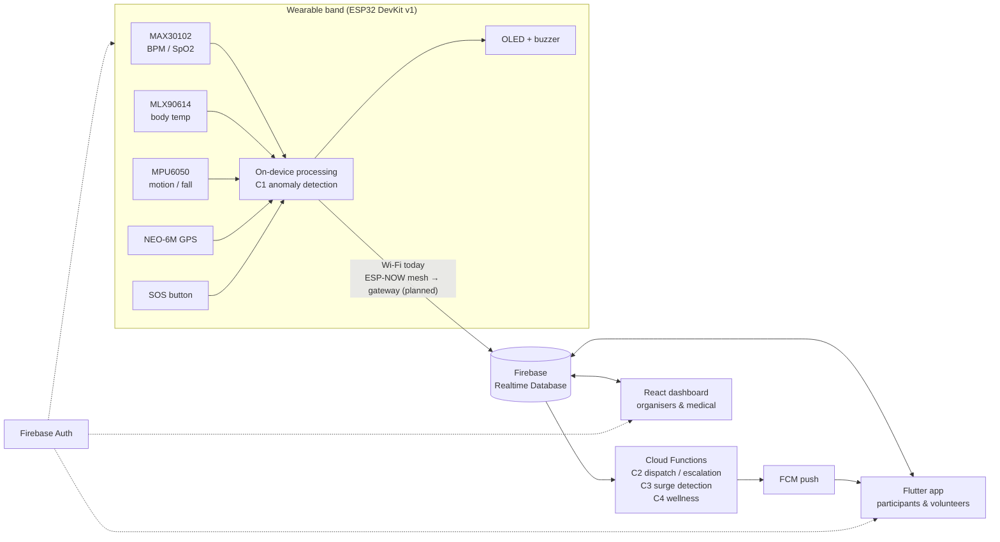

# FestNet Architecture Overview

## Data flow

1. **Band → RTDB.** The band authenticates with its own Firebase Auth account and `set`s
   `/festnet/devices/{deviceId}/latest` every few seconds (target 2 s). With C1 it also pushes
   `history` snapshots and creates `/festnet/alerts/{id}` when it detects an anomaly or an SOS press.
2. **RTDB → Cloud Functions (C2–C4).** Database triggers react to new alerts and data: FCM dispatch,
   volunteer proximity (Haversine, 50 m), auto-escalation after 2 min, crowd surge detection and heat stress.
3. **RTDB → apps.** The dashboard and the app subscribe to live data with the Firebase SDKs.
   No custom server is needed.

## Design decisions

| Decision | Reason |
|---|---|
| Realtime Database rather than Firestore | Low-latency streaming of small, frequently overwritten documents; the band's existing code already uses it |
| One shared contract (`docs/database/schema.md` + `Backend/functions/src/shared`) | Four people build against the same data; a single source avoids drift |
| `deviceIndex/` node | Apps list bands without downloading every band's `history` |
| Online status from **client receive time** | The current firmware has no wall-clock timestamp (`updatedAtMs` is `millis()`) |
| On-device anomaly detection (C1) | Sub-100 ms local detection; works even when the network is down |
| Detection logic on the band, dispatch logic in Functions | C1 has no dependency on the Blaze plan; C2 can iterate on alerting independently |
| Band per-device Auth accounts + `deviceAuth/{uid}` | Security rules can limit each band to writing only its own node |

## Security model (summary — see `Backend/database.rules.json`)

| Who | Can read | Can write |
|---|---|---|
| Band (device account) | own `devices/{id}` | own `latest`, `history`, `location`, `meta`; create `alerts` for itself |
| Participant | own `users/{uid}`, paired band's `devices/{id}`, `events`, `deviceIndex`, own `wellness` | own profile (cannot raise own role), claim an unpaired band |
| Volunteer | as participant + `alerts` | as participant |
| Medical | all `devices`, `users`, `alerts`, `wellness` | `alerts` (acknowledge / resolve) |
| Organiser | everything above | `config`, `events`, `deviceIndex`, `deviceAuth`, user roles |

## Planned: ESP-NOW mesh

The TAF goal is that bands do not each need Wi-Fi. The planned design: bands send compact packets
over ESP-NOW to a **gateway ESP32**, and the gateway uploads to Firebase using the same JSON and
paths. Apps and Functions need no changes, because the database contract stays the same.
