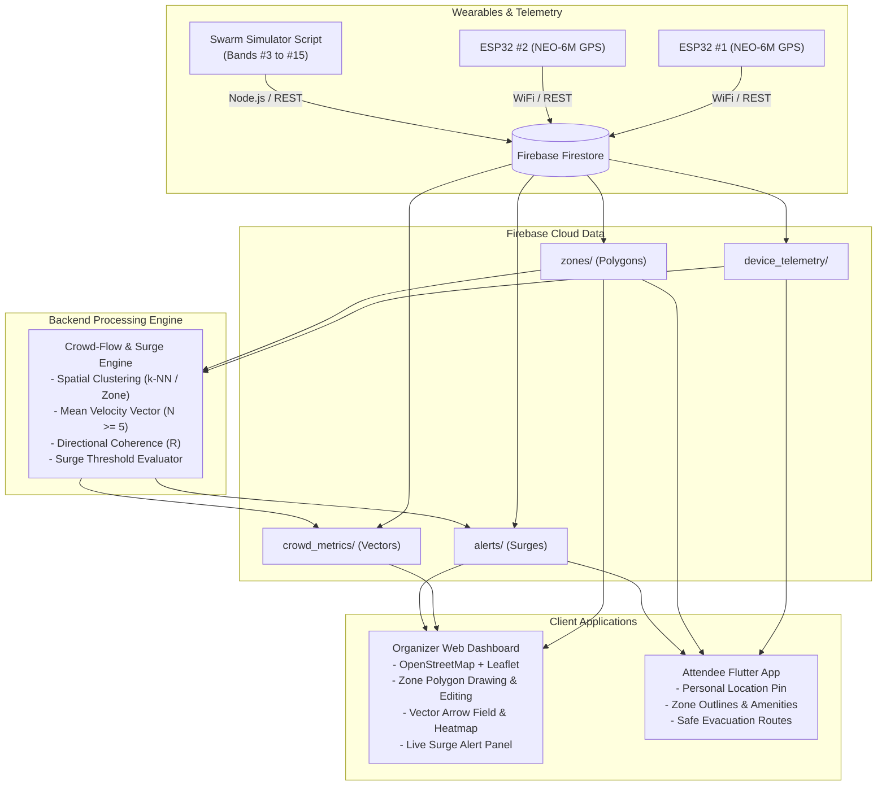
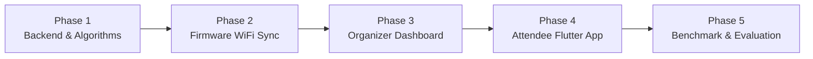

# FestNet: Location & Crowd Tracking Component Plan

> **Component Scope**: Real-time GPS tracking from wearable devices (ESP32 + NEO-6M), dynamic event-zone polygon mapping, multi-device crowd-flow direction analysis ($\ge 5$ devices), surge detection alerts, organizer dashboard visualization, and attendee mobile navigation.

---

## 1. What to Do Outside Coding (Zero-Cost Setup Checklist)

You do **not** need to spend any money or enter any credit card details. Everything in this plan runs on **100% free, open-source tiers**.

### A. Google Firebase Setup (Cloud Database)
1. **Sign in to Firebase Console**:
   - Go to [console.firebase.google.com](https://console.firebase.google.com/) using any Google account.
2. **Create a Project**:
   - Click **Add Project** and name it (e.g., `festnet-it427`).
   - Disable Google Analytics for this project (or keep it enabled; it's free either way).
   - Ensure the project is on the **Spark Plan (Free - \$0/month)**.
3. **Enable Cloud Firestore**:
   - In the left sidebar, navigate to **Build > Firestore Database**.
   - Click **Create Database**.
   - Select a location close to you (e.g., `asia-south1` or `asia-southeast1`).
   - Choose **Start in test mode** for initial development (allows read/write without authentication blocks during testing).
4. **Obtain Web Credentials (for Dashboard)**:
   - Go to **Project Settings** (gear icon) > **General**.
   - Scroll down to *Your apps* and click the **Web icon (`</>`)**.
   - Name it `FestNet-Dashboard` and register the app.
   - Copy the `firebaseConfig` object (keys: `apiKey`, `authDomain`, `projectId`, `storageBucket`, `messagingSenderId`, `appId`).
5. **Obtain Mobile Credentials (for Flutter App)**:
   - In the same *Your apps* section, click the **Android icon**.
   - Enter package name (e.g., `com.festnet.app`).
   - Download the generated `google-services.json` file (save it to your local machine; we will place it into `MobileApp/android/app/`).

### B. Wi-Fi Hotspot for ESP32 Wearable
- During outdoor testing or away from home routers, the ESP32 needs an internet connection to push GPS coordinates to Firebase.
- Enable your **Mobile Phone Wi-Fi Hotspot** (ensure band is set to **2.4 GHz**, as standard ESP32 boards do not support 5 GHz).
- Note down your Hotspot **SSID** and **Password** to embed into the firmware configuration.

### C. Map Tiles & Location Services
- **No account required**: We will use **OpenStreetMap (OSM)** served via Leaflet (`react-leaflet`) for the Dashboard and `flutter_map` for the Flutter mobile application.
- Public tile servers require zero API keys, zero tokens, and zero billing setup.

### D. Physical Hardware Testing Note (GPS Fix)
- The NEO-6M GPS antenna requires direct line-of-sight to satellites.
- When testing the 2 physical ESP32 boards, place the GPS antenna **outdoors or directly on an open windowsill**.
- The small onboard LED on the NEO-6M module will begin **blinking consistently** once it has acquired a satellite fix (typically 4+ satellites).

---

## 2. End-to-End System Architecture



---

## 3. Core Research Mathematical Formulations

### A. Individual Device Velocity Vector
For each wearable $i$ reporting ground speed $s_i$ (in $\text{m/s}$) and heading angle $\theta_i$ (in degrees, clockwise from North):

$$\vec{v}_i = \begin{bmatrix} v_{ix} \\ v_{iy} \end{bmatrix} = \begin{bmatrix} s_i \cdot \sin(\theta_i) \\ s_i \cdot \cos(\theta_i) \end{bmatrix}$$

### B. Mean Crowd Velocity Vector ($\ge 5$ Devices)
For a group of $N \ge 5$ devices located within the same polygon zone or spatial cluster radius:

$$\vec{V}_{avg} = \frac{1}{N} \sum_{i=1}^{N} \vec{v}_i = \begin{bmatrix} \frac{1}{N} \sum v_{ix} \\ \frac{1}{N} \sum v_{iy} \end{bmatrix}$$

- **Dominant Flow Heading ($\theta_{dominant}$)**:
  $$\theta_{dominant} = \left( \operatorname{atan2}(V_{avg, x},\; V_{avg, y}) \cdot \frac{180}{\pi} + 360 \right) \pmod{360}$$
- **Average Movement Speed ($S_{avg}$)**:
  $$S_{avg} = \|\vec{V}_{avg}\| = \sqrt{V_{avg, x}^2 + V_{avg, y}^2}$$

### C. Directional Coherence / Order Parameter ($R$)
To distinguish between random wandering and coordinated crowd movement:

$$R = \frac{1}{N} \left\| \sum_{i=1}^{N} \frac{\vec{v}_i}{\|\vec{v}_i\|} \right\| \quad (0 \le R \le 1)$$

- **$R < 0.40$**: Random, independent movement (normal festival dispersion).
- **$0.40 \le R < 0.75$**: Moderate crowd alignment (steady movement towards stage or exit).
- **$R \ge 0.75$**: Highly synchronized, unidirectional mass movement.

### D. Surge Warning Decision Matrix

$$\text{Alert Status} = \begin{cases} 
\mathbf{CRITICAL\_SURGE}, & \text{if } N \ge 5 \land R \ge 0.75 \land S_{avg} \ge S_{critical\_threshold} \ (\approx 7\text{ km/h}) \\
\mathbf{HIGH\_FLOW\_WARNING}, & \text{if } N \ge 5 \land R \ge 0.70 \land S_{avg} \ge S_{warn\_threshold} \ (\approx 4.5\text{ km/h}) \\
\mathbf{NORMAL}, & \text{otherwise}
\end{cases}$$

---

## 4. Firestore Data Models

### Collection: `device_telemetry/{deviceId}`
```json
{
  "deviceId": "BAND-001",
  "attendeeId": "ATT-9812",
  "latitude": 7.119075,
  "longitude": 80.047517,
  "altitude": 55.0,
  "speed": 1.2,
  "heading": 134.5,
  "satellites": 6,
  "currentZoneId": "ZONE-STAGE-MAIN",
  "updatedAt": "2026-10-19T03:00:00Z"
}
```

### Collection: `zones/{zoneId}`
```json
{
  "id": "ZONE-STAGE-MAIN",
  "name": "Main Stage Arena",
  "type": "STAGE", 
  "polygon": [
    {"lat": 7.1195, "lng": 80.0470},
    {"lat": 7.1198, "lng": 80.0485},
    {"lat": 7.1185, "lng": 80.0488},
    {"lat": 7.1182, "lng": 80.0473}
  ],
  "capacity": 5000,
  "surgeSpeedThresholdKmH": 6.5,
  "color": "#ef4444"
}
```

### Collection: `crowd_metrics/{zoneId}`
```json
{
  "zoneId": "ZONE-STAGE-MAIN",
  "deviceCount": 14,
  "dominantHeadingDeg": 95.2,
  "averageSpeedKmH": 7.8,
  "coherenceScore": 0.88,
  "status": "CRITICAL_SURGE",
  "lastCalculated": "2026-10-19T03:00:05Z"
}
```

### Collection: `alerts/{alertId}`
```json
{
  "id": "ALERT-20261019-001",
  "zoneId": "ZONE-STAGE-MAIN",
  "type": "CROWD_SURGE",
  "severity": "CRITICAL",
  "message": "Potential crowd surge detected moving East at 7.8 km/h",
  "speed": 7.8,
  "heading": 95.2,
  "deviceCount": 14,
  "timestamp": "2026-10-19T03:00:05Z",
  "status": "ACTIVE"
}
```

---

## 5. Phased Implementation Roadmap



### Phase 1: Backend Foundation & Algorithm Engine
- [x] Create TypeScript types for `DeviceTelemetry`, `EventZone`, `CrowdMetric`, and `SurgeAlert` in `Backend/functions/src/types/`.
- [x] Implement Point-in-Polygon (Ray casting / `@turf/boolean-point-in-polygon`) in `Backend/functions/src/utils/geoMath.ts`.
- [x] Implement Vector Math & Surge Detection in `Backend/functions/src/services/crowdAnalysisService.ts`.
- [x] Build the Multi-Device Swarm Simulator script in `Backend/scripts/simulate_crowd.ts` (supports 3 benchmark scenarios: Random Wander, Coherent Walk, High-Speed Surge).

### Phase 2: Wearable Firmware-to-Cloud Integration
- [x] Add Wi-Fi connection logic to `Firmware/src/sensors/GPS/GPS.ino`.
- [x] Implement lightweight HTTP POST or Firebase REST payload publishing every 3–5 seconds when fix is valid.
- [x] Flash and verify both physical ESP32 boards streaming live coordinates.

### Phase 3: Organizer Dashboard (Crowd & Zone Map)
- [x] Integrate Leaflet (`react-leaflet` + OpenStreetMap tiles) in `Dashboard/src/features/crowd_monitoring/`.
- [x] Add Interactive Polygon Zone Editor (organizer can click on the map to define Stages, Gates, Medical Tents).
- [x] Render Live Device Markers & Swarm Density.
- [x] Render Dominant Flow Direction Vector Arrows on each zone.
- [x] Connect real-time Surge Warning popups and banners.

### Phase 4: Attendee Mobile App (Flutter)
- [ ] Integrate `flutter_map` with OpenStreetMap tiles in `MobileApp/lib/features/festival_location/`.
- [ ] Render attendee's current GPS location pin.
- [ ] Fetch and display active event polygon zones and key points of interest (First Aid, Toilets, Exits).
- [ ] Receive crowd congestion notifications or safe detour alerts if current zone triggers a surge warning.

### Phase 5: Experimental Evaluation & Benchmark Metrics
- [ ] Run automated validation runs through the simulator script.
- [ ] Measure **Direction Detection Error** (target vector vs calculated vector).
- [ ] Measure **Surge Detection Latency** (time in seconds from speed increase to alert trigger).
- [ ] Measure **Packet Delivery Reliability** over Wi-Fi.
